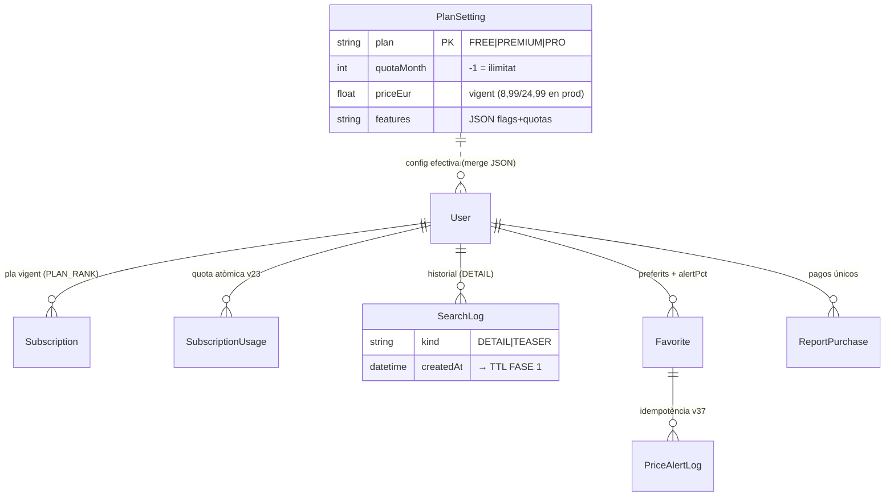
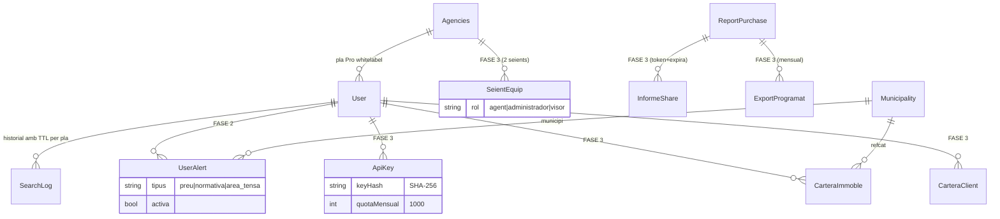

# Plans Preureal — FASE 0: Auditoría y preparación (migración progresiva)

> Entrega de la FASE 0 del encargo «Planes Preureal (migración progresiva)».
> **Sin cambios visibles**: no se ha tocado ninguna tabla de producción, ningún precio,
> ningún texto publicado. Este documento es el mapa antes/después que guía las FASES 1–3.
>
> **Inmutables verificados (§1 del encargo) — NO TOCAR**: precios vigentes, fuentes oficiales,
> mensajes legales, límites publicados, identidad de marca, Stripe. Cada fase de este plan se
> refiere explícitamente a estas líneas rojas.

---

## 1. Mapa del modelo de planes actual (antes)

### 1.1 Dónde vive cada cosa

| Pieza | Fichero / tabla | Rol |
| --- | --- | --- |
| Defaults de código | `src/lib/plans.ts` (`PLANS`) | Fuente por defecto de cuotas, precios y flags |
| Config efectiva | Tabla **`PlanSetting`** (una fila por plan) | La BD **sobrescribe** los defaults (merge JSON, caché 30 s); editable desde el admin sin desplegar |
| API pública | `GET /api/plans` | Devuelve la config efectiva (la que muestra la página /preus) |
| UI de precios | `src/components/views/PricingView.tsx` | Precios desde `/api/plans`; bullets desde `i18n.ts` (`plans.*.feats`) |
| Cuota de consultas | `SubscriptionUsage` (`DETAIL_QUERY`) | Fuente atómica v23/v31 (contar SearchLog ya NO aplica quota) |
| Gate de consultas | `src/lib/consulta-gate.ts` (`gateDetailedQuery`) | 401 sin sesión · 402 quota · server-side real (v46) |
| Quotas PDF/valoraciones | `features.pdfMonth` / `features.valoracionsMonth` | `-1` = ilimitado; fallback defensivo al default |
| Historial de consultas | `SearchLog` (kind `DETAIL`) + `GET/DELETE /api/history` | Hoy gateado con `features.historial` (boolean) |
| Alertas | `Favorite.alertPct`/`tenseNoticed` + `PriceAlertLog` + cron `/api/cron/emails` (secció 0.6, v61) | Alertas de precio/área tensada sobre los **preferits** |
| Export CSV | `features.exportCsv` + `/api/export/[code]`, `/api/export/dataset`, `/api/comparator/export` (v60/v61) | Gating PRO, CSV + XLSX |
| Informes pagos únicos | `ReportPurchase` (v38.8) + `/api/reports/shop/*` | 4,99 / 6,99 / 7,99 € (catalog 499/699/799 cents) |
| Suscripciones | `Subscription` + Stripe (`checkout`, `webhook`, `portal`) | `VIGENT_STATUSES`, `syncUserPlan` auto-curativo |
| Herramienta «Consulta» (A–D) | `/analitza` + `analitza-html.ts`: **A. Preu · B. Normativa · C. Serveis · D. Checklist** | HTML imprimible a PDF; gate v46 |
| Análisis de mercado | `/analisi` («Anàlisi del mercat residencial») | 4 gráficos (preu, contractes, població, volum) |

### 1.2 Precios: código vs producción (verificado en vivo contra `https://www.preureal.com/api/plans`)

| Plan | Default de código | **Producción (BD, vigente)** | Inmutable del encargo | ¿Coincide? |
| --- | --- | --- | --- | --- |
| Gratuït | 0 € · 3 consultes/mes | 0 € · 3 consultes/mes | 0 € / 3 consultes | ✅ |
| Premium | 7,99 € · ilimitades | **8,99 €** · 7 consultes/mes ⚠️ | 8,99 €/mes | ✅ precio · ⚠️ cuota |
| Pro·agents | 19,99 € · ilimitades | **24,99 €** · ilimitades | 24,99 €/mes | ✅ precio |
| Pagos únicos | 4,99 / 6,99 / 7,99 € | catálogo 499/699/799 cents (env-configurable) | 4,99 / 6,99 / 7,99 € | ✅ |

**Conclusión**: los precios inmutables del encargo son EXACTAMENTE los vigentes en producción vía
`PlanSetting`. Los defaults de código (7,99/19,99) y los textos i18n de fallback («7,99 €»/«19,99 €»)
quedan DESACTUALIZADOS pero son cosméticos (la página muestra siempre la cifra de la BD si carga;
si no carga, muestra el fallback). **No se modifica ningún precio.**

### 1.3 Diff JSON: defaults de código vs config efectiva en producción

```json
{
  "FREE": {
    "diff": [],
    "nota": "producción == defaults de código"
  },
  "PREMIUM": {
    "diff": [
      {"clave": "quotaMonth",      "codigo": -1,    "produccion": 7,     "riesgo": "ALTO: contradice el bullet publicado «Consultes il·limitades»"},
      {"clave": "historial",       "codigo": true,  "produccion": false, "riesgo": "MEDIO: el historial de consultas está apagado en BD para Premium"},
      {"clave": "pdfMonth",        "codigo": 5,     "produccion": false, "riesgo": "BAJO: tipo incorrecto (boolean); pdfLimitForPlan() cae al default 5 por el fallback defensivo — sin efecto visible"},
      {"clave": "evolucioTemporal","codigo": true,  "produccion": false, "riesgo": "MEDIO: gráfico de series apagado en BD para Premium"}
    ]
  },
  "PRO": {
    "diff": [
      {"clave": "priceEur",   "codigo": 19.99, "produccion": 24.99, "riesgo": "NINGUNO: precio vigente correcto (immutable)"},
      {"clave": "pdfEdifici", "codigo": true,  "produccion": false, "riesgo": "BAJO: coherente con «illa de cases pendents del conveni Incasòl»"}
    ]
  }
}
```

> **Recomendación (NO aplicada — requiere decisión del propietario)**: alinear `PlanSetting` de
> Premium con lo publicado («Consultes il·limitades», historial activo, `pdfMonth` numérico 5,
> `evolucioTemporal` activo). Es un cambio **aditivo/restaurador** (el encargo prohíbe que un plan
> pierda funcionalidades ya listadas), pero toca el comportamiento de pago: se entrega como SQL
> revisable en la sección 4 y se aplicará solo con aprobación explícita.

### 1.4 Bullets publicados hoy (i18n ca, literal)

- **Gratuït (5)**: Mapa de tota Catalunya · Fins a 3 consultes detallades cada mes · Preu mitjà real
  per municipi · Marcador d'àrea tensada · Comparador fins a 2 municipis
- **Premium (7)**: Consultes il·limitades · Banda P25–P75 i posició del teu preu · Indicadors oficials
  INE · Històric de lloguer per municipi (2005–2025) · Comparador 6 municipis amb columnes avançades ·
  Informe PDF professional (5/mes) · Suport prioritari
- **Pro·agents (6)**: Tot el de Premium · Exportació CSV per municipi · Informes PDF 10 pàgines, també
  d'edifici (30/mes) · Ideal per a agents i gestors · Accés prioritari a noves dades · Factura nominal

*(El encargo habla de «6 bullets» en Gratuït: el recuento real es 5; se añade sin eliminar ninguno.)*

---

## 2. Cobertura: qué ya existe (anti-duplicados)

| Punto del encargo | Estado real hoy | Acción |
| --- | --- | --- |
| F1 «Checklist pre-firma + informe imprimible (blocs A–D)» | **Ya existe**: la herramienta Consulta (`/analitza`) genera el informe imprimible con blocs A. Preu / B. Normativa / C. Serveis / D. Checklist | Explicitarlo como bullet del Gratuït (Nou) con enlace a la herramienta |
| F1 «Historial de consultes 7 dies» | Infraestructura lista (`SearchLog` + `/api/history`) pero gateada solo a pago | Activar para Gratuït con **TTL 7 dies** (ventana en la API + cron de purga RGPD) |
| F1 «Sense targeta» | El landing ya lo dice («Registro gratuito · sin tarjeta · …») | Explicitarlo como bullet del Gratuït (Nou) |
| F1 subtexto «3 consultes» | Bullet existe literal | Añadir el subtexto del encargo (literal + traducción es) |
| F2 «Motor Valora v2 il·limitat» | Motor v2 en producción (`/api/estima`, quota `valoracionsMonth`: Free 0 · Premium 5 · Pro 30) | FASE 2: `valoracionsMonth = -1` para Premium vía PlanSetting/defaults |
| F2 «Mòdul normatiu (índex referència, IRAV, gran tenidor)» | Ya en el bloc **B. Normativa** del informe Consulta (endpoint existente) | FASE 2: listarlo como feature Premium (copy) |
| F2 «Alertes de preu i normativa» | Ya hay alertas de preu/àrea tensada sobre preferits (v37/v61, idempotentes) | FASE 2: tabla `UserAlert` por municipi+tipus + cron diario |
| F2 «Historial il·limitat» | Gate `features.historial` (BD Premium: false) | FASE 2: activar (`historialTtlDies = -1`) — ver recomendación §1.3 |
| F3 white-label / annex / shares | `ReportPurchase` con snapshot de params y token hasheado | FASE 3: `Agencies` + `metadata` + `InformeShare` (token + expira_at) |
| F3 CSV massiu + sèrie històrica | `/api/export/dataset` (v61) ya da CSV/XLSX masivo municipal con sèrie anual | FASE 3: `ExportProgramat` (programación mensual) |
| F3 API de lectura | No existe (solo web + cron) | FASE 3: `ApiKey` + rate limiter (`rate-limit.ts` ya existe) |
| F3 dades edifici/illa | Mapa ya preparado («illa de cases» intacta, conveni Incasòl pendent) | FASE 3: badge «Pròximament» + flag `edifici_ready` |
| F3 cartera / seients / anual / SLA | No existe | FASE 3: tablas nuevas + Stripe `billing_interval=yearly` |

---

## 3. Modelo §5 del encargo vs esquema real (decisiones trazables)

| Tabla del encargo | Decisión | Justificación |
| --- | --- | --- |
| `consultes_usuari` (TTL) | **No se crea** — se reutiliza `SearchLog` + política TTL (`historialTtlDies`) | Duplicaría el historial existente (principio anti-duplicados de la FASE 0). La quota ya vive en `SubscriptionUsage` (v31) y NO debe volver a depender de SearchLog |
| `alertes_usuari` | **Se crea en FASE 2** como `UserAlert` | Extiende el sistema v37/v61 (`PriceAlertLog` ya es idempotente) |
| `agencies` | **Se crea en FASE 3** | White-label |
| `informes_shares` | **Se crea en FASE 3** como `InformeShare` | Sobre `ReportPurchase` (equivalente a `informes_pdf`) |
| `api_keys` | **Se crea en FASE 3** | Con `rate-limit.ts` existente |
| `cartera_immobles/clients/compliment`, `seients_equip`, `exports_programats` | **Se crean en FASE 3** | Sin equivalentes existentes |
| `plans`/`features` | **No se crean** — ya existen como `PlanSetting` (editable sin desplegar) | Evitar tabla paralela |

### Diagrama ER — ANTES (estado actual, simplificado)



### Diagrama ER — DESPUÉS (tras FASES 1–3; verde = nuevo)



---

## 4. SQL de realineación de Premium (PROPUESTO — no aplicado)

Idempotente y reversible (inverso documentado). Solo se ejecuta con aprobación del propietario,
porque toca el comportamiento del plan de pago:

```sql
-- Restaurar en BD lo publicado (Premium): consultes il·limitades + historial + pdfMonth numérico
-- Inverso: UPDATE "PlanSetting" SET "quotaMonth"=7, "features"=jsonb_set(features::jsonb,'{historial}','false')::text WHERE "plan"='PREMIUM';
UPDATE "PlanSetting"
SET "quotaMonth" = -1,
    "features"   = ((("features")::jsonb
                     || '{"historial":true,"evolucioTemporal":true,"pdfMonth":5}'::jsonb))::text
WHERE "plan" = 'PREMIUM';
```

---

## 5. Criterios de DONE de la FASE 0

- [x] Mapeados `plans` (código) y `features` (PlanSetting BD) — §1.1/§1.3
- [x] Diff JSON antes/después + diagrama ER — §1.3/§3
- [x] Documentada la cobertura existente para evitar duplicados — §2
- [x] Tablas §5 asignadas a fases con justificación — §3
- [x] Precios inmutables verificados contra producción — §1.2
- [x] Ningún cambio visible aplicado
